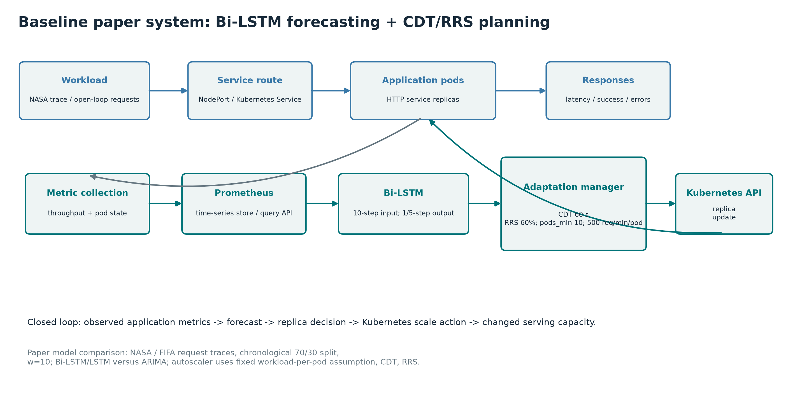
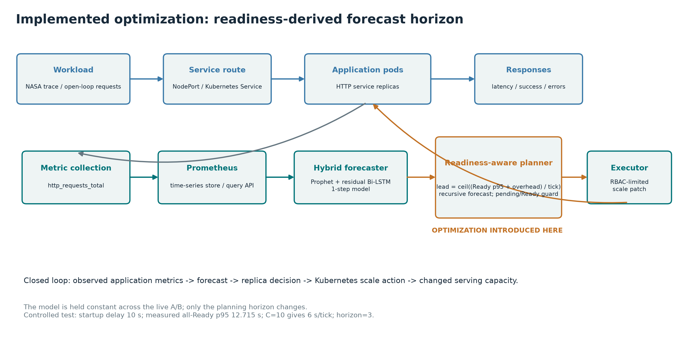
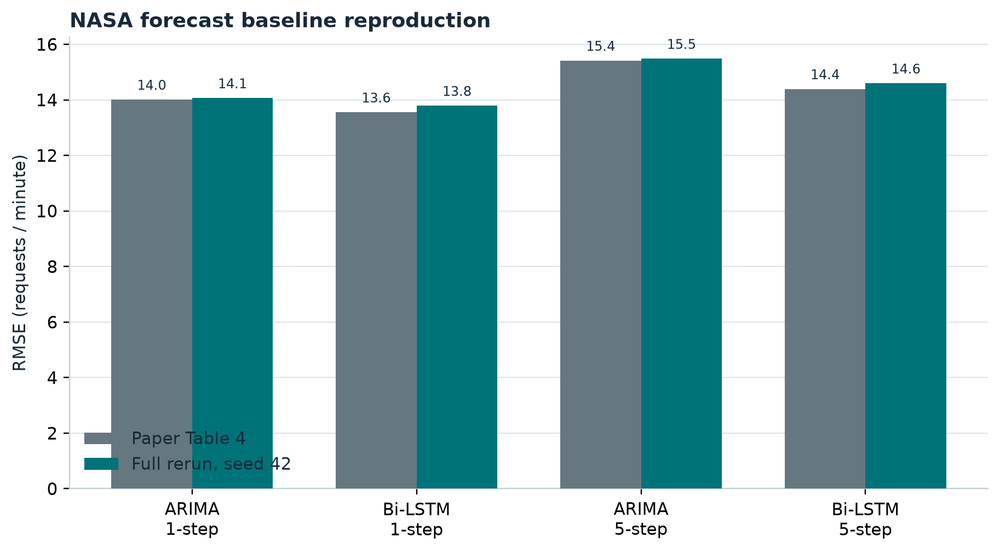
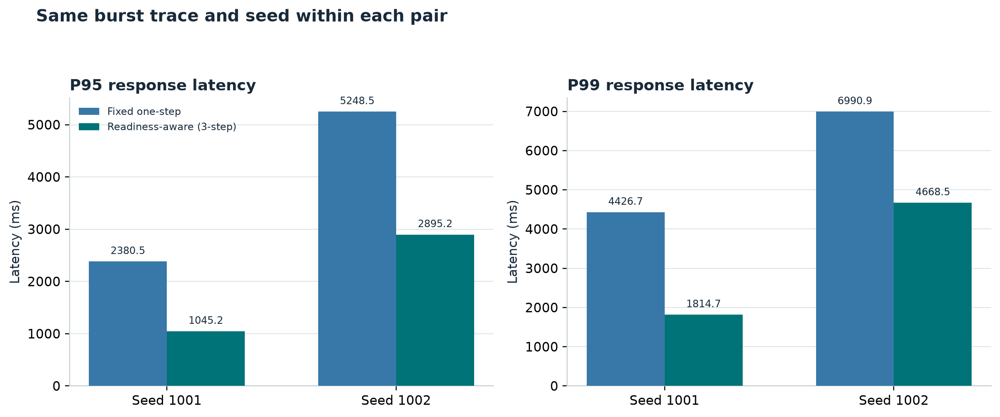
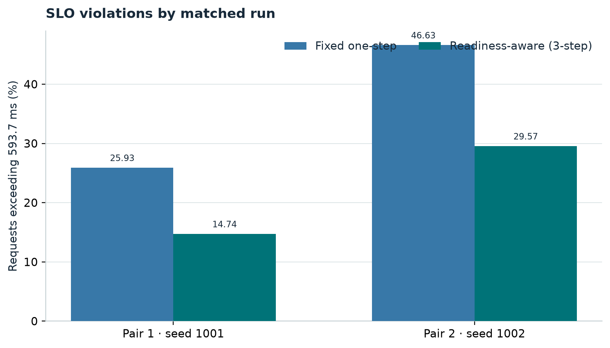
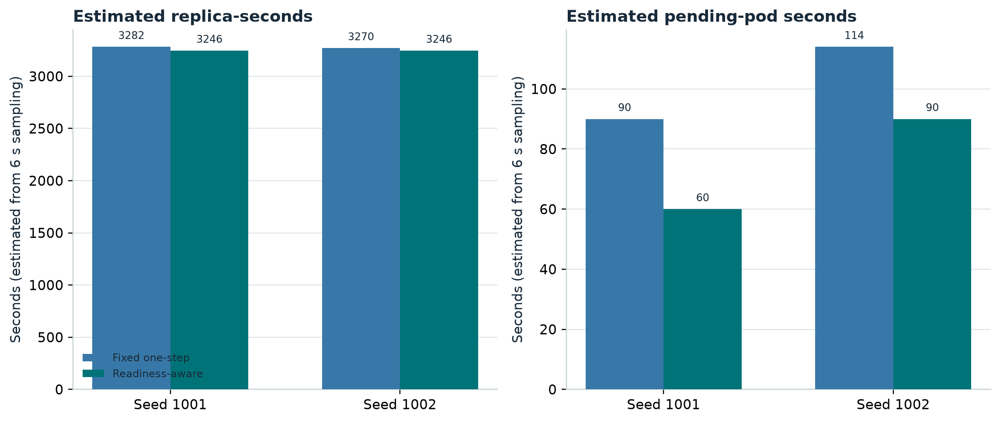
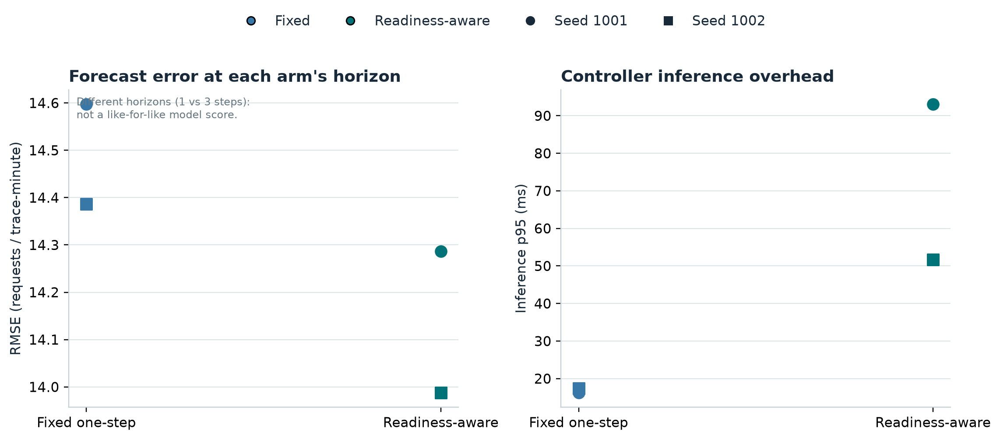
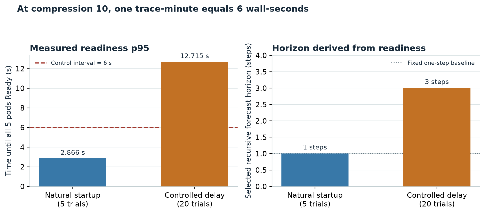
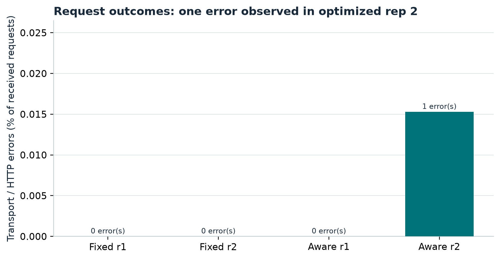

# Examiner Guide: Bi-LSTM Autoscaling and Cold-Start-Aware Planning

**Evidence date:** 29 September 2026  
**Reference paper:** N.-M. Dang-Quang and M. Yoo, "Deep Learning-Based Autoscaling Using Bidirectional Long Short-Term Memory for Kubernetes," *Applied Sciences*, 11 (2021), 3835. DOI: 10.3390/app11093835.

## Executive position

The repository contains two related but distinct bodies of work:

1. An offline reproduction of the paper's forecasting and Algorithm 1 autoscaler experiments.
2. A live KIND testbed using Prometheus and a Prophet-plus-residual-network controller, extended with a readiness-derived recursive forecast horizon.

The live optimization was compared against the same live hybrid controller using its fixed one-step horizon. Under a controlled 10-second application startup delay, two matched burst-trace pairs showed lower tail latency, fewer SLO violations, slightly lower estimated replica-seconds, and lower pending time for the readiness-aware policy. There was one `ClientPayloadError` in readiness-aware replicate 2. This is promising pilot evidence (n=2), not a statistically significant result and not a direct live comparison against the paper's Bi-LSTM + CDT/RRS controller.

## 1. Examiner demonstration order

Open only these files, in this order. Each item states what it proves and the best code anchor to show.

### Baseline implementation

| Order | File and anchor | Why to show |
|---|---|---|
| 1 | `README.md`, sections "Method" and "Expected results" | Identifies the cited paper, reproduction scope, parameter choices, and caveats. |
| 2 | `run_experiment.py`: constants around line 55; `run_nn` line 83; `run_arima` line 96; `experiment_one` line 119 | Shows the experiment driver, 10-step window, 30 units, 50 epochs, batch 64, ARIMA(4,1,0), and 1-/5-step comparisons. |
| 3 | `src/models/paper.py`: `build_lstm` line 14, `build_bilstm` line 26, `train_nn` line 38, `arima_walk_forward` line 58 | Shows the paper-style prediction models and train/evaluate implementations. |
| 4 | `src/autoscaler.py`: `pods_required` line 24 and `run_autoscaler` line 33 | Shows the offline Algorithm 1 simulation: capacity-based pod count, floor, and partial scale-in. |
| 5 | `src/metrics.py`: `accuracy_metrics` line 13, `elasticity_metrics` line 31, `elastic_speedup` line 57 | Shows prediction and SPEC-style simulated elasticity metrics. |

### Optimization

| Order | File and anchor | Why to show |
|---|---|---|
| 6 | `src/controller/config.py`: `Config` line 85; scale-up cooldown line 210; required/capped horizon lines 233/240; shortfall line 245 | Shows the time conversion, p95 readiness input, overhead, horizon cap, capacity, and cooldown calculation. |
| 7 | `src/controller/forecaster.py`: `Forecaster` line 60; `predict` line 186; `predict_horizon` line 240 | Shows the unchanged live hybrid forecaster and the recursive use of its packaged one-step model. |
| 8 | `src/controller/planner.py`: `Planner` line 68; `plan` line 98 | Shows the normal replica formula, scale-up/down safeguards, confirmation/dead-band logic, and hold while replicas are pending. |
| 9 | `src/controller/main.py`: `main` line 83; trace-clock resolution around line 126; horizon choice around line 184; planning around line 223 | Shows how Prometheus observations, predictions, planning and Kubernetes execution connect, and how trace time is aligned to the replay. |
| 10 | `src/controller/executor.py`: `Executor` line 34; read line 46; scale patch line 54 | Shows the Kubernetes API integration and the actual scale-subresource patch. |
| 11 | `src/controller/test_planner.py` and `src/controller/test_forecaster_horizon.py` | Shows the tested horizon derivation, cap/shortfall, pending scale-down guard, and recursive forecast window updates. |

### Experimental and evaluation code

| Order | File and anchor | Why to show |
|---|---|---|
| 12 | `src/eval/coldstart.py`: `one_trial` line 98; `main` line 164 | Shows the measured 1-to-5 scale-out procedure, readiness timestamps, repetitions and separate output path. |
| 13 | `experiments/run_coldstart_pair.sh`: parameters near the top; `run_arm` line 52; policy/env switch around line 64 | Shows matched fixed/readiness-aware runs, same seed within pairs, identical trace/app/model/capacity, and artifact capture. |
| 14 | `load/trace_replay.py`: compression line 78; `build_schedule` line 105; `summarise` line 172; `main` line 219 | Shows open-loop Poisson workload generation, replay timing, request results and latency summaries. |
| 15 | `results/presentation_nasa_20260929/live_pair/scored_results.md` and its four `*/summary.json`, `*/decisions.jsonl`, and `*/requests.csv` files | These are the primary live evidence: every run's HTTP outcomes, latency distribution, decisions and per-seed score. |

### Dataset and input generation

| Order | File and anchor | Why to show |
|---|---|---|
| 16 | `data/raw/NASA_access_log_Jul95.gz` and `data/raw/NASA_access_log_Aug95.gz` | Original NASA HTTP log inputs. The attached archives match these copies. |
| 17 | `src/data/preprocess_nasa.py`: documented counts line 42; parser `count_minutes` line 81; CLI `main` line 127 | Proves raw-log line counting, timestamp/timezone validation and per-minute aggregation. |
| 18 | `data/nasa_invocation_count.csv`, `data/processed/nasa_requests_per_min.csv`, `src/data/core.py` loader line 35 | Shows input formats and the continuous minute grid with absent minutes filled as zero. |
| 19 | `load/segments.json`, `load/segments.py` | Shows the checksummed held-out burst/diurnal/quiet trace windows used by live experiments. |
| 20 | `RUN_ON_COLAB.ipynb` | Optional execution instructions only. It has no executed cells; do not use it as proof of results. |

### Results and deployment

| Order | File and anchor | Why to show |
|---|---|---|
| 21 | `results/presentation_nasa_20260929/tables/table_nasa_accuracy.csv` and `figures/nasa_baseline_rmse.png` | Refreshed full NASA Table 4 baseline run and paper-value comparison. |
| 22 | `results/presentation_nasa_20260929/slow_start_coldstart.json` and `figures/readiness_horizon.png` | Measures the controlled slow-start condition used to derive three forecast steps. |
| 23 | `figures/live_pair_latency.png`, `live_pair_slo.png`, `live_pair_resource_use.png`, `forecast_overhead.png`, `request_errors.png` | Presentation-quality plots generated from saved metrics, not fabricated values. |
| 24 | `k8s/kind-config.yaml` | Three-node KIND topology and cluster-level HPA timing configuration. |
| 25 | `k8s/app.yaml`: Deployment/readiness/liveness from line 17; probes around 76/91; ServiceMonitor from 130 | Shows app resource requests/limits, health/readiness behavior, Service and Prometheus scrape wiring. |
| 26 | `k8s/controller.yaml`: RBAC/Deployment from line 13; measured p95 and mode near lines 125-132 | Shows least-privilege scale access and live controller configuration. |
| 27 | `k8s/prometheus-values.yaml`: scrape interval around line 57; `k8s/deploy_predictive_autoscaler.sh` | Shows monitoring cadence and reproducible image deployment helper. |

**Avoid opening:** large trained model binaries, raw 1.3-billion-request FIFA source formats, unrelated experiment directories, or the `RUN_ON_COLAB.ipynb` as a result artifact. Bring up those items only if asked.

## 2. Baseline explanation

### Problem statement

Cloud workloads vary over time. Provisioning too few replicas can violate latency/service-level objectives; provisioning too many wastes resources. Reactive autoscalers wait for observed resource pressure before acting, so pod scheduling and startup add delay. The 2021 paper studies whether predicting future HTTP request load can make Kubernetes horizontal scaling more proactive and accurate.

### Baseline paper and architecture

The primary baseline is Dang-Quang and Yoo (2021). It describes a Monitor-Analyze-Plan-Execute loop:

1. A load generator sends HTTP traffic through a load balancer to a Kubernetes service and its pods.
2. An application metric collector obtains throughput/response-time information; Prometheus stores time series and pod information.
3. A Bi-LSTM forecasting service uses the most recent 10 minutes to predict the next one minute or the next five minutes.
4. An adaptation manager converts forecast request workload to replica demand.
5. Kubernetes applies the replica change through its API.

The comparison models are ARIMA and forward LSTM. The paper's Bi-LSTM has a forward and backward LSTM direction, 30 hidden units per direction/cell, ReLU, MSE, Adam, batch size 64, up to 50 epochs, and early stopping. The reproduced driver uses a chronological 70/30 split. NASA counts stay in raw request units; FIFA is scaled to [-1, 1].

The reproduced Algorithm 1 assumes one pod serves 500 requests/minute, maintains at least 10 pods, scales out immediately, waits a 60-second cooling-down period, and applies a 60% resource-removal strategy when scaling in. The repository simulates this policy and calculates SPEC-style under/over-provisioning and elastic-speedup metrics.

### What is paper-derived versus project implementation

Paper-derived: Bi-LSTM/LSTM/ARIMA comparison, input window and horizons, NASA/FIFA traces, Algorithm 1 capacity formula, CDT/RRS values, and reported tables.

Implemented reproduction choices: deterministic ARIMA recursion equivalent to the package forecast for the chosen ARIMA order; chronological windowing; the selected NASA/FIFA normalization; fixed simulation baselines; and the local result/plot pipeline. These choices are documented in `README.md` and `results/REPRODUCTION_SUMMARY.md`.

Important distinction: the notebook/project's live KIND controller is not the paper's Bi-LSTM controller. It uses the project’s Prophet-plus-residual-network hybrid. The live optimization comparison below isolates a planning-policy change while keeping that live forecaster fixed. It does not prove the new controller beats the paper's exact system.

### Baseline bottleneck

A fixed t+1 forecast is only useful if requested pods become Ready before the forecasted demand arrives. In the natural-start measurement, all-five-ready p95 was 2.8662 seconds and the compressed controller interval was 6 seconds; the derived horizon was one step. To exercise a true multi-step condition, the pilot injected a controlled 10-second startup delay and measured all-five-ready p95 of 12.715 seconds, yielding ceil((12.715 + 0.01)/6) = 3 steps.

The paper's fixed policy does not derive its forecast lead from measured readiness, and its simulated intervals do not model sub-minute pod startup. This is the opportunity tested here.

## 3. Implemented optimization

The controller retains the live hybrid model and replica-capacity formula. The changed planning logic is:

```text
required_steps = max(1, ceil((pod_ready_p95_wall_s + forecast_overhead_wall_s)
                             / control_period_wall_s))
used_steps = min(required_steps, max_forecast_horizon_steps)
forecast = recursively_apply_one_step_model(used_steps)
replicas = ceil((forecast + calibrated_error_margin) / per_pod_capacity)
replicas = clamp(replicas, min_replicas, max_replicas)
```

The error margin is currently zero; the code supports a configured value but this pilot did not calibrate one. If the readiness requirement exceeds the forecast cap, the controller logs the shortfall and uses recent observed demand as a conservative fallback. It does not silently claim full coverage.

The planner also holds scale-down while requested replicas are not all Ready. Existing dead-band, scale-down confirmation and cooldown safeguards remain. Scale-up remains immediate after the cooldown; the configured scale-up cooldown has a physical floor equal to measured readiness p95 to prevent repeated requests against stale replica state.

Why this is an optimization: both live arms use the same forecaster, app, capacity, SLO, trace segment, replica limits and request seed. The intended independent variable is the planning horizon: fixed one-step versus readiness-derived three-step. The change targets a measured provisioning delay and uses metrics tied to that mechanism.

Trade-offs: recursive forecast error compounds; the three-step controller's inference p95 was higher than one-step (see graph/table); a conservative margin could over-provision; and this test injects startup delay rather than representing a real production image pull or service initialization.

## 4. Architecture diagrams

### Baseline

The report embeds `figures/architecture_baseline.png`. Flow: NASA/JMeter workload -> load balancer/service -> pods; application metrics -> Prometheus -> Bi-LSTM forecast -> CDT/RRS adaptation manager -> Kubernetes API -> replica count.



### Optimized live system

The report embeds `figures/architecture_optimized.png`. Flow: open-loop trace replay -> target-app pods -> Prometheus ServiceMonitor/counter -> 60-minute live monitor -> Prophet plus residual Bi-LSTM -> readiness-aware recursive horizon planner -> RBAC-limited scale patch -> pods. The orange planner box is where this optimization is introduced.



The code's monitor/controller time is compressed by C=10 (one trace-minute is six wall seconds), but pod startup remains wall-clock time.

## 5. Experimental setup and parameters

- Cluster: three-node KIND (one control plane, two workers); all nodes share the same host, so they are not independent physical machines.
- Kubernetes: v1.30.0; Prometheus Operator/kube-prometheus-stack in namespace `monitoring`; project app/controller in `aiops`.
- App: small HTTP service, 200m CPU request/500m limit, 128Mi memory request/256Mi limit, configured CPU work per request, `/readyz`, `/healthz`, `/metrics`.
- Data/workload: frozen NASA-HTTP burst segment, 180 trace-minutes, 24 Aug 1995 06:52-09:51; held-out test data; open-loop Poisson arrivals; C=10, six wall seconds per trace-minute.
- Capacity: measured 3.135 requests/second per pod against p95 SLO 593.7 ms; min/max replicas 1/10.
- Startup condition: `STARTUP_DELAY_S=10`; 20 repeated 1-to-5-pod scale-outs measured all-Ready mean 12.640 s and interpolated p95 12.715 s. The original natural-start p95 is 2.8662 s from five trials.
- Arms: fixed horizon 1 versus readiness-aware horizon 3; same Prophet+residual-Bi-LSTM model and same app/capacity/trace/settings. Seeds 1001 and 1002 were paired.
- Metrics: per-request p50/p95/p99 latency, SLO violation fraction at 593.7 ms, errors; replica-seconds and pending-pod seconds estimated from six-second decision samples; scale actions/reversals; forecast RMSE/bias/underforecast frequency at each arm's own horizon; inference p95.

Not measured in this two-pair A/B: CPU utilization, memory utilization, cloud cost, HPA-vs-optimized policy, and statistical confidence intervals. Do not infer them from replica counts.

## 6. Results and scientific analysis

### NASA paper baseline reproduction

The full one-run NASA table is a refreshed CPU run on the zero-filled 89,280-minute series. `figures/nasa_baseline_rmse.png` compares the actual Table 4 reference and this rerun:

The source archives contain 3,461,612 parsed requests; one malformed/truncated record was omitted. The resulting continuous July-August series has 89,280 minute bins, including 7,884 zero-request minutes. The refresher was run in a Python 3.11 container with TensorFlow CPU 2.16.2 and Statsmodels 0.15 because the host Python 3.14 environment cannot run TensorFlow.

| Horizon | Model | Paper RMSE | Rerun RMSE | Relative difference |
|---|---|---:|---:|---:|
| 1-step | ARIMA | 14.010 | 14.063 | +0.4% |
| 1-step | Bi-LSTM | 13.551 | 13.788 | +1.7% |
| 5-step | ARIMA | 15.414 | 15.481 | +0.4% |
| 5-step | Bi-LSTM | 14.390 | 14.594 | +1.4% |

This is close accuracy reproduction, not identical reproduction. TensorFlow initialization/runtime/hardware affect neural values. The previously saved FIFA and Table 6 files were not rerun after correcting the shared NASA zero-fill/package path and should not be presented as fresh results.



### Live cold-start pilot

| Metric (mean across 2 pairs) | Fixed horizon | Readiness-aware | Change |
|---|---:|---:|---:|
| p95 latency | 3,814.5 ms | 1,970.2 ms | -48.4% |
| p99 latency | 5,708.8 ms | 3,241.6 ms | -43.2% |
| SLO violations | 36.28% | 22.15% | -14.12 percentage points (-38.9%) |
| Estimated replica-seconds | 3,276 | 3,246 | -0.9% |
| Estimated pending-pod seconds | 102 | 75 | -26.5% |
| Scale actions / direction reversals per run | 8.5 / 4 | 7.5 / 3 | lower |
| Request errors | 0 | 1 total | one `ClientPayloadError`, readiness-aware rep 2 |













Observed result: both seeds reduced p95, p99 and SLO violations. Paired p95 deltas were -1,335.4 ms and -2,353.3 ms. The second optimized run had one transport error; it remains included, not discarded.

Interpretation: under this controlled startup delay, a longer lead was associated with lower tail latency/SLO violation fraction and slightly lower estimated replica usage. The mechanism is plausible because the forecast lead (18 seconds) exceeds measured all-Ready p95 (12.715 seconds). The two repeated pairs are directionally consistent but too few to establish statistical significance. This does not establish a general win for all workloads or natural startup.

Trade-offs: inference p95 increased from a mean 16.84 ms in fixed mode to 72.35 ms in three-step mode, still small relative to the 6,000 ms control interval. Horizon-specific forecast RMSE and underforecast rates are shown in `figures/forecast_overhead.png`; since lead times differ, do not interpret those as a like-for-like model accuracy comparison. Replicate under natural start and multiple delay/workload levels.

## 7. Examiner demonstration file order

Show these in this order; avoid opening large binaries or unrelated run folders.

### Baseline implementation

1. `README.md` - paper citation, method/hyperparameters, and caveats.
2. `run_experiment.py` - `WINDOW/UNITS/EPOCHS/BATCH/ARIMA_ORDER` constants and `experiment_one` / `experiment_two`.
3. `src/models/paper.py` - `build_lstm`, `build_bilstm`, `train_nn`, `arima_walk_forward`.
4. `src/autoscaler.py` - `pods_required`, `run_autoscaler` for Algorithm 1.
5. `src/metrics.py` - accuracy and SPEC elasticity metrics.
6. `src/data/core.py` - schema-aware loader, minute gap filling, split/window preparation.

### Optimization

7. `src/controller/config.py` - readiness p95, clock conversion, required/capped horizon and cooldown.
8. `src/controller/forecaster.py` - unchanged hybrid and recursive `predict_horizon`.
9. `src/controller/planner.py` - replica calculation, pending guard, cooldown/dead-band/confirmations.
10. `src/controller/main.py` - Prometheus-monitor-analyze-plan-execute flow and decision logging.
11. `src/controller/executor.py` - Ready/spec replica reads and RBAC-scale patch.
12. `src/controller/test_planner.py`, `src/controller/test_forecaster_horizon.py` - tested safety/horizon behavior.

### Evaluation, dataset, results and deployment

13. `src/eval/coldstart.py` - readiness trial definition and stage breakdown.
14. `experiments/run_coldstart_pair.sh`, `results/presentation_nasa_20260929/live_pair/experiment_params.txt` - paired policy switch and frozen experiment settings.
15. `load/trace_replay.py`, `load/segments.json` - open-loop schedule and held-out trace window.
16. `src/data/preprocess_nasa.py`, `data/raw/NASA_access_log_Jul95.gz`, `data/raw/NASA_access_log_Aug95.gz` - raw data to minute series.
17. `results/presentation_nasa_20260929/tables/table_nasa_accuracy.csv`, `live_pair/scored_results.md`, `slow_start_coldstart.json` - model baseline, live A/B, and measured readiness.
18. `figures/architecture_baseline.png`, `architecture_optimized.png`, `live_pair_latency.png`, `live_pair_slo.png`, `live_pair_resource_use.png`, `forecast_overhead.png`, `readiness_horizon.png` - visual evidence.
19. `k8s/kind-config.yaml`, `k8s/app.yaml`, `k8s/controller.yaml`, `k8s/prometheus-values.yaml`, `k8s/deploy_predictive_autoscaler.sh` - cluster, app, monitoring, controller and deployment.
20. `RUN_ON_COLAB.ipynb` is unexecuted; describe it only as an optional recipe, not as result evidence.

## 8. Five-to-ten-minute spoken script

**1. Problem statement.** "My project studies proactive horizontal autoscaling for Kubernetes. Workload changes over time; reactive scaling waits for utilization signals, while pod startup itself takes time. The goal is to have enough Ready replicas when demand arrives without keeping excess capacity permanently."

**2. Baseline approach.** "I reproduced Dang-Quang and Yoo's 2021 forecasting experiments. They compare Bi-LSTM, forward LSTM and ARIMA on per-minute NASA and FIFA HTTP request traces, with one- and five-step prediction. Their autoscaler converts forecast workload to pods using a fixed capacity assumption and uses cooldown plus partial scale-in to reduce oscillation."

**3. Baseline architecture.** "The paper describes a MAPE loop: collect application throughput and response-time metrics, store the time series in Prometheus, forecast with Bi-LSTM, let an adaptation manager choose a replica count, and execute the change through Kubernetes. In my offline reproduction, the model comparison and Algorithm 1 simulation are implemented separately so the forecast metrics and elasticity metrics can be checked."

**4. Limitation.** "A one-step forecast only helps if new capacity becomes Ready within that step. In the compressed live test, one trace-minute is six seconds. Natural startup was faster than that, so it did not exercise the optimization. I introduced a documented 10-second app startup delay and measured all-Ready p95 at 12.715 seconds over 20 trials."

**5. Optimization.** "I changed the planning horizon, not the live model. The controller computes required steps as the ceiling of readiness p95 plus inference overhead divided by the control interval. That selects three steps here. It recursively applies the packaged one-step hybrid forecaster to get that lead, records any cap shortfall, and refuses to scale down while requested replicas are still Pending."

**6. Implementation.** "The monitor gets request counts from Prometheus. The hybrid forecaster returns predicted load. The planner divides it by measured per-pod capacity, clamps to one through ten replicas, and applies the cooldown and downscale safeguards. The executor reads the Deployment state and patches the scale subresource with narrow RBAC. I also added tests for horizon selection, cap behavior, recursive forecasts and pending-pod scale-down protection."

**7. Experimental setup.** "I used a three-node KIND cluster with a synthetic HTTP app, Prometheus, an open-loop Poisson replay of the held-out NASA burst segment, compression factor ten, and capacity calibrated at 3.135 requests per second per pod. Both arms used the same hybrid forecaster, app, SLO, replica limits, trace and random seed within each pair. The only intended difference was a fixed one-step versus readiness-derived three-step planning horizon."

**8. Results.** "Across two paired seeds, mean p95 fell from 3,814.5 to 1,970.2 milliseconds, a 48.4 percent reduction. Mean p99 fell 43.2 percent. SLO violations above 593.7 milliseconds fell from 36.28 to 22.15 percent. Estimated replica-seconds changed by less than one percent, and pending-pod time fell 26.5 percent. There was one ClientPayloadError in the second readiness-aware run; I kept it in the results."

**9. Graph interpretation.** "The paired plots show the direction held for both seeds, not just the average. The resource plot indicates the p95 improvement did not come from a large increase in replica-seconds. Inference p95 rose from about 16.8 to 72.3 milliseconds because the model is run recursively three times, but that remains small compared with the six-second control interval."

**10. Contribution and limitations.** "The contribution demonstrated here is a measured-readiness-aware planning horizon on a live KIND testbed, not a new Bi-LSTM. This is a two-pair pilot, so I do not claim statistical significance, production generality, or superiority over the paper's exact Bi-LSTM/CDT/RRS system. The comparator is the same live hybrid controller with a fixed horizon."

**11. Conclusion.** "The first two paired runs provide consistent pilot evidence that matching forecast lead to pod readiness can improve tail latency and SLO behavior at similar estimated replica use under slow startup. Next I need more pairs, additional startup/workload conditions, confidence intervals, and a paper-faithful live baseline before making a journal-level claim."

## 9. Likely examiner questions and concise answers

**Why this paper?** It is directly about proactive Kubernetes autoscaling with Bi-LSTM and includes public NASA/FIFA traces plus stated forecasting and scaling settings, which makes a reproducible baseline possible.

**What is your novelty?** The tested extension is a readiness-derived forecast lead and Pending-pod-aware scale-down guard in the planning layer. I do not claim a new forecasting architecture.

**Why should it work?** A replica request made 12.7 seconds before demand can be Ready; a six-second one-step lead is too short. The three-step lead covers about 18 seconds, leaving roughly five seconds after the measured all-Ready p95.

**Why not train another model?** The live A/B holds the forecaster fixed to isolate the planning-policy effect. A model replacement would confound attribution. The paper model reproduction is separately measured offline.

**How did you measure improvement?** Two matched open-loop trace pairs with identical seed within each pair; per-request latency/status, SLO violations, replica/pending samples, decisions, horizon and inference timing were recorded.

**Is it statistically significant?** No. Two pairs support a promising repeatable direction, not a significance claim. More repetitions and paired confidence intervals are required.

**What are the trade-offs?** Recursive inference takes longer and compounds forecast error. In this pilot inference p95 is about 72 ms, still below the six-second tick. One optimized request failed in rep 2 and is retained. Underforecasting on sharp ramps remains a limitation.

**Were CPU and memory utilization measured in this A/B?** No. Do not claim CPU/memory utilization or cost improvement from this pair. The paired experiment records request latency, replica/pending estimates, actions, forecast metrics and inference time.

**Did you beat the 2021 paper?** Not established. This live A/B compares the same Prophet+residual-Bi-LSTM controller with two planning horizons. The paper-faithful Bi-LSTM + CDT/RRS evaluation is offline/simulated in this repository.

**What did you implement?** The paper predictor/Algorithm 1 reproduction and data pipeline; the NASA loader correction; the readiness-aware config/planner/recursive inference/logging; Kubernetes manifests/RBAC; cold-start measurement and the paired replay/scoring/visual evidence.

## 10. Conclusion and next work

The refreshed NASA baseline is a close single-run accuracy reproduction. The controlled two-pair live pilot favors readiness-aware planning on p95/p99 latency, SLO violation fraction and pending time, with a single request error and no meaningful replica-seconds increase. Treat this as preliminary evidence. Next: run at least ten paired repetitions, test natural and multiple controlled startup delays, include load patterns beyond one NASA burst, report paired uncertainty, and add the paper's exact Bi-LSTM/CDT/RRS controller as a separate live comparator.

## References

1. Dang-Quang, N.-M.; Yoo, M. *Deep Learning-Based Autoscaling Using Bidirectional Long Short-Term Memory for Kubernetes.* Applied Sciences 2021, 11, 3835. DOI: 10.3390/app11093835.
2. Guruge, A.; Priyadarshana, C. *Time series forecasting-based Kubernetes autoscaling using Facebook Prophet and LSTM.* Frontiers in Computer Science 2025, 7, 1509165. This is background for the repository's live hybrid forecaster, not the 2021 reproduction baseline.
3. NASA-HTTP access logs, NASA Kennedy Space Center WWW server, July-August 1995; archived by the Internet Traffic Archive (ITA).
